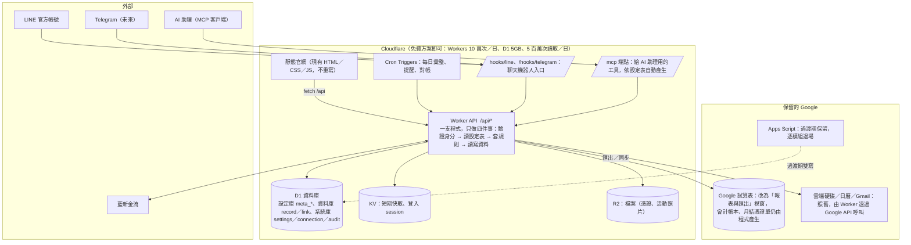
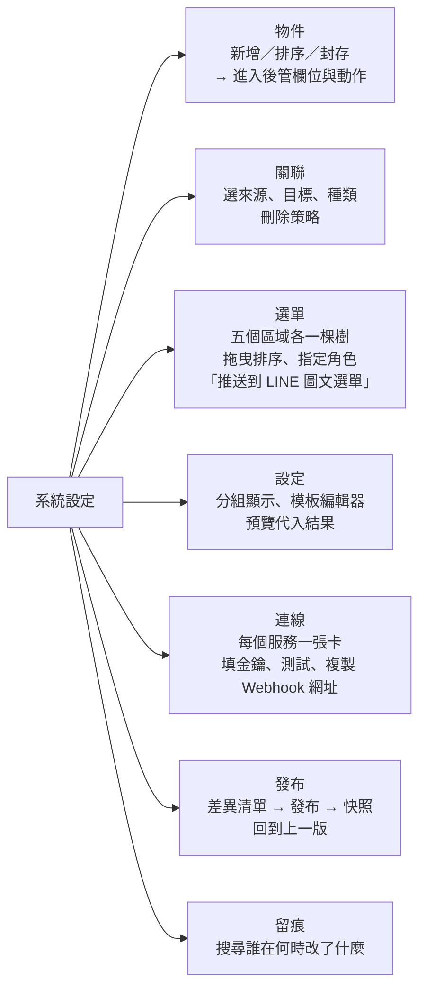

# 寓委聯資訊系統規範

版本 1.0 ｜ 2026-11-05 ｜ 維護：秘書處（官網對話負責程式與部署）

這份文件有三個部分：

1. **現況組織圖**：目前已經做好、正在運作的所有系統，彼此怎麼接。
2. **下一代架構（Cloudflare D1）**：資料搬進資料庫後長什麼樣、怎麼分階段搬。
3. **設定驅動規範**：物件、欄位、關聯、選單、設定、連線，全部放在「設定資料庫」裡用畫面管理；程式只讀設定表運作，不把物件與關聯寫死在程式裡。

---

## 第一部分：現況組織圖

### 1.1 全景

```mermaid
flowchart LR
  subgraph 使用者
    G[一般民眾／客人]
    M[會員]
    V[志工]
    S[秘書處]
  end

  subgraph 官網["官網（靜態頁，Cloudflare Workers 代管，GitHub push 即自動部署）"]
    P1[公開頁：首頁／關於／活動成果／服務／出版／會員名單／廠商自薦／隱私]
    P2[會員專區 portal／線上入會 join／課程報名 events／訂購手冊 order／付款 pay]
    P3[志工專區 volunteer／志工申請／請款 claim／器材 equipment／活動建檔 archive／討論串 forum]
    P4[行政中心 admin]
  end

  subgraph GAS["後端：Google Apps Script（部署帳號 ccs2024taiwan，17 個 .gs 檔）"]
    API[doPost：約 50 個 action]
    MENU[試算表選單：入會／訂單／會費／志工／會計／器材／LINE／討論串]
    JOB[定時工作：每日彙整、提醒、對帳、備份比對、週報]
  end

  subgraph Google["Google（試算表 owner：commiteesorority2023）"]
    SS[(入會申請表單 (回覆) 主試算表\n表單回應 1、設定、任務、志工資料、書籍訂單、會費繳納紀錄、\n課程活動、志工請款紀錄、器材借用單、日記帳、收支表、收據登記簿…)]
    SS2[(其他試算表：協會資產控管表、會員版廠商資料、書籍銷售紀錄)]
    DRV[雲端硬碟：會員共享資料夾、交貨便匯入、憑證 PDF]
    CAL[日曆：會議、器材預約]
    GM[Gmail：所有通知信（自動接信件簽名）]
    MEET[Meet 小程式（舊帳號部署，開會議室）]
  end

  subgraph 外部
    NP[藍新金流 MPG：信用卡／ATM]
    LINE[LINE 官方帳號 寓委聯小幫手：圖文選單、Webhook 機器人、推播]
    FB[FB 粉專／社團]
  end

  G & M & V & S --> 官網
  官網 -->|fetch POST JSON| API
  S --> MENU
  API & MENU & JOB --> SS & SS2 & DRV & CAL & GM
  API -->|預約核准| MEET
  API <-->|付款表單／通知| NP
  LINE <-->|Webhook ?line=金鑰| API
  LINE --> 官網
  FB --> 官網
```

### 1.2 模組一覽（現況）

| 模組 | 前端頁 | 後端檔 | 主要資料表（工作表） | 外部服務 |
|---|---|---|---|---|
| 會籍與入會 | join、portal、members | Code.gs、Review.gs、Dues.gs | 表單回應 1、入會申請備份、會費繳納紀錄、登入紀錄 | 藍新（J 入會費、D 會費）、LINE 審核訊息 |
| 訂書 | order、pay | Orders.gs、Pay.gs、Aes.gs | 書籍訂單、書籍銷售紀錄 | 藍新（B 訂單、B…S 補繳）、7-11 交貨便匯入 |
| 課程報名 | events | Events.gs | 課程活動、各場次報名表 | 藍新（E）、Google 地圖連結 |
| 志工 | volunteer、volunteer-join、claim | Admin.gs、Claims.gs | 志工資料、任務、參與紀錄、志工請款紀錄、榮譽志工 | 每日彙整信 |
| 器材與會議室 | equipment | Equipment.gs | 器材借用單、協會資產控管表、道具器材 | 日曆、Meet 小程式 |
| 會計 | （試算表選單） | Ledger.gs、Claims.gs | 日記帳、收支表、銀行明細、收據登記簿、月結憑證 | Google 文件（憑證單） |
| 活動建檔 | archive | Archive.gs、Zip.gs、Envelope.gs | 活動建檔、檔案 | 雲端硬碟 |
| 討論串 | forum | Forum.gs、Seed.gs | 討論串、留言 | — |
| 廠商 | vendors、portal | Code.gs | 推薦廠商、會員版廠商資料 | — |
| LINE 機器人 | — | Line.gs | LINE綁定、LINE推播紀錄 | LINE Messaging API |
| 行政中心 | admin | Admin.gs | 設定、提醒 | — |

### 1.3 現況的限制（為什麼要有第二部分）

- **每次讀取 3～4 秒起跳**：Apps Script 冷啟動加試算表讀取，快取只能撐 2 分鐘。
- **物件與欄位寫死在程式裡**：新增一種資料（例如「贊助廠商」）就要改 .gs、改 HTML、改 script.js 三處。
- **資料靠人手守護**：兩次「資料消失」都是人在試算表誤刪列，程式只能事後比對。
- **金鑰靠指令或指令碼屬性**：藍新、LINE、Meet 密鑰要人打指令或到編輯器貼，非工程背景不友善。

---

## 第二部分：下一代架構（Cloudflare Workers ＋ D1）

### 2.1 目標架構圖



### 2.2 D1 是什麼、怎麼用（給非工程背景）

- D1 是 Cloudflare 提供的 SQLite 資料庫，跟官網放在同一個地方，Worker 讀它大約 10～50 毫秒，比現在快一百倍。
- **建立**：Cloudflare 後台 → Storage & Databases → D1 → Create，取名 `ccs`。免指令。
- **綁定**：在 `wrangler.jsonc` 加一段 `d1_databases`（這一步由官網對話改檔推上去即可），之後 Worker 程式用 `env.DB` 就能查。
- **看資料**：D1 後台有「Console」可以直接下 SQL 查、看表，也有「Tables」分頁可以瀏覽每一列。日常不需要碰，行政中心會有畫面。
- **備份**：D1 內建 Time Travel，30 天內任何時間點可以還原整個資料庫（解決「誰刪了那一列」的問題）。另外每天 Cron 匯出一份 JSON 到 R2，保留 90 天。
- **限制**：單一資料庫 10GB 上限（我們全部資料不到 50MB），不適合放大量照片（照片放 R2）。

### 2.3 分三階段搬，每一階段都可停、可退

| 階段 | 做什麼 | 使用者有感的改變 | 風險 |
|---|---|---|---|
| **① 讀取加速**（1～2 週） | Apps Script 每次寫入後把該列同步到 D1（雙寫）；Worker 提供 `/api/read/*` 讀 D1。前端把「會員名單、課程、討論串、器材、志工專區首頁」等讀取改走 Worker | 頁面 0.3 秒內載入 | 低：寫入仍在試算表，D1 只是鏡像，錯了重同步 |
| **② 設定驅動 ＋ 新模組**（1～2 個月） | 建立第三部分的 meta 表與行政中心「系統設定」畫面；**新的 CRM／ERP 需求（客戶、廠商、合作案、庫存）一開始就建在 D1**，不經過試算表 | 行政中心可以自己加物件、加欄位、改選單；AI 助理能透過 MCP 查資料 | 中：兩套資料來源並存，要清楚哪個物件以誰為準（設定表裡有「主資料來源」欄） |
| **③ 既有模組搬家**（逐模組，各 1～2 週） | 依序：討論串 → 器材 → 課程報名 → 志工／請款 → 訂書 → 會籍 → 會計。每搬一個，Apps Script 對應的 .gs 退場，試算表變成「匯出報表」 | 試算表仍看得到資料（唯讀鏡像），但改資料要到行政中心 | 中：會計與金流最後搬，先累積信心 |

不重構的原則：前端 HTML 不重寫，只改 `script.js` 裡 `api()` 的目的地；每一個 Apps Script action 對應一個 Worker 路由，回傳格式相同，前端無感。

---

## 第三部分：設定驅動規範（設定資料庫）

### 3.1 核心原則

1. **程式不認識任何業務物件**。「會員」「訂單」「器材」對程式來說都只是 `meta_object` 的一列。新增物件＝在畫面新增一列，不改程式、不部署。
2. **三層分離**：設定庫（meta_*，描述「有什麼」）、資料庫（record／link，存「實際資料」）、系統庫（settings／connection／audit，存「怎麼運作」）。
3. **所有改動留痕**：設定與資料的每一次新增、修改、刪除都寫 `audit`，含誰、何時、改前改後。刪除一律軟刪除（`deleted_at`），30 天後才由 Cron 真刪。
4. **畫面優先**：任何需要人填的東西（金鑰、網址、選單順序）都在行政中心「系統設定」填，不打指令。唯一例外是 Worker 的主金鑰 `MASTER_KEY`（用來加密其他金鑰），在 Cloudflare 後台「Settings → Variables and Secrets」填一次，之後不再碰。
5. **設定表有版本**：每次「發布」設定會存一份快照（`meta_release`），出問題可以一鍵回到上一版。

### 3.2 設定庫：物件、欄位、關聯、選單

#### meta_object（物件）

| 欄位 | 型別 | 說明 |
|---|---|---|
| id | text PK | 英文代號，例 `member`、`order`、`asset`。建立後不可改 |
| label | text | 顯示名稱，例「會員」 |
| label_plural | text | 複數顯示，例「會員名單」（可空） |
| icon | text | emoji 或圖示代號 |
| id_rule | text | 編號規則，例 `{city}{seq:5}`、`B{yyMMdd}{seq:3}`；空＝ULID |
| title_field | text | 哪個欄位當標題顯示（例 `name`） |
| source | text | 主資料來源：`d1`（預設）、`sheet:<試算表ID>/<工作表>`（過渡期鏡像） |
| soft_delete | int | 1＝軟刪除（預設） |
| audit_level | text | `full`（記改前改後）、`basic`（只記誰何時） |
| acl | json | 誰能看／建／改／刪，見 3.6 |
| sort | int | 排序 |
| status | text | `active`／`hidden`／`archived` |
| updated_at, updated_by | | |

#### meta_field（欄位）

| 欄位 | 型別 | 說明 |
|---|---|---|
| id | text PK | ULID |
| object_id | text FK→meta_object | 屬於哪個物件 |
| key | text | 欄位代號（英文），同物件內唯一 |
| label | text | 顯示名稱 |
| type | text | 見下表 |
| options | json | 選項（select／multiselect）、關聯目標（relation）、公式（formula）等 |
| required | int | 必填 |
| unique | int | 不可重複 |
| default | text | 預設值，可用 `{today}`、`{me}` |
| validate | text | 驗證規則：正則或內建名稱（`phone_tw`、`email`、`roc_year`） |
| privacy | text | `public`（官網可顯示）、`member`（登入後）、`staff`（秘書處）、`secret`（只寫不回傳，例手機） |
| show_in_list | int | 列表預設顯示 |
| sort | int | 表單順序 |
| help | text | 欄位說明（顯示在表單下方） |

欄位型別：

| type | 說明 | options 範例 |
|---|---|---|
| text / textarea / richtext | 文字 | `{"max": 200}` |
| number / money / percent | 數字 | `{"min": 0, "unit": "元"}` |
| date / datetime / time | 日期時間 | `{"roc": true}` 民國年顯示 |
| select / multiselect | 單選／複選 | `{"items": ["待審核","在職","離職"]}` 或 `{"from": "settings:志工狀態"}` |
| boolean | 是／否 | |
| phone / email / url / line_id | 格式化文字，自帶驗證 | |
| relation | 關聯到另一物件（見 meta_relation） | `{"relation": "member_community"}` |
| file / image | 存 R2，欄位存檔案 id | `{"max_mb": 10, "accept": "image/*"}` |
| formula | 唯讀計算欄 | `{"expr": "qty * price"}`、`{"expr": "lookup(member.until)"}` |
| sequence | 自動編號 | `{"rule": "E{yyMMddHHmmss}{rand:2}"}` |
| json | 自由結構（給程式用） | |

#### meta_relation（關聯）

| 欄位 | 型別 | 說明 |
|---|---|---|
| id | text PK | 代號，例 `order_member` |
| label | text | 顯示名稱，例「訂購人」 |
| from_object | text FK | 來源物件，例 `order` |
| to_object | text FK | 目標物件，例 `member` |
| kind | text | `many_to_one`（訂單→會員）、`one_to_many`、`many_to_many`（活動↔志工） |
| from_label / to_label | text | 兩邊各自怎麼稱呼（「訂購人」／「訂單紀錄」） |
| on_delete | text | `restrict`（有關聯就不准刪，預設）、`cascade`、`set_null` |
| required | int | 來源建立時必須指定 |
| display | json | 下拉選單顯示哪些欄位、怎麼搜尋：`{"show": ["id","name"], "search": ["name","phone"]}` |

多對多關聯的實際資料存在 `link` 表（見 3.3），一對多存在來源物件的 relation 欄位裡。程式只看這張表決定能不能刪、要不要連帶。

#### meta_menu（選單）

一張表同時驅動四個地方：官網主選單、會員專區服務卡、志工專區服務卡、行政中心側欄。LINE 圖文選單也能從這裡「推送」（需 LINE 連線）。

| 欄位 | 型別 | 說明 |
|---|---|---|
| id | text PK | |
| area | text | `site`（官網頂部）、`portal`（會員）、`volunteer`（志工）、`admin`（行政中心）、`line`（圖文選單） |
| parent_id | text | 子選單 |
| label | text | 顯示文字 |
| icon | text | |
| kind | text | `page`（靜態頁）、`object`（開某物件的列表）、`view`（開某個檢視）、`url`（外部）、`action`（呼叫動作） |
| target | text | 依 kind：`events.html`／`member`／`view:unpaid_dues`／`https://…`／`action:export_cvs` |
| roles | json | 哪些角色看得到，例 `["staff","volunteer"]`；空＝所有人 |
| badge | text | 角標來源，例 `count:claim?status=待審核` |
| sort | int | |
| visible | int | |

#### meta_view（檢視）與 meta_action（動作）

- **meta_view**：某物件的「一種看法」：篩選條件、顯示欄位、排序、分組，例「還沒繳會費的有效會員」。選單可以直接指到檢視。
- **meta_action**：按鈕。`kind`＝`status_change`（改狀態）、`notify`（寄信／LINE 推播，模板在 settings）、`export`（匯出 xlsx／交貨便格式）、`webhook`（呼叫外部）、`script`（Worker 內建的具名流程，例「確認收款」）。每個 action 有 `roles`、`confirm_text`、`when`（出現條件）。

現在試算表的選單（入會①②③、訂單、會費、志工、會計…）之後就是 `meta_action` 的列，行政中心依物件顯示按鈕。

### 3.3 資料庫：record 與 link

所有業務資料只用兩張表，結構由設定庫決定，不隨物件增加而加表：

```sql
CREATE TABLE record (
  id          TEXT PRIMARY KEY,          -- 業務編號（依 meta_object.id_rule）或 ULID
  object_id   TEXT NOT NULL,             -- 對應 meta_object.id
  data        TEXT NOT NULL,             -- JSON：{ "name": "...", "phone": "...", ... } 鍵＝meta_field.key
  status      TEXT,                      -- 常用狀態抽出來方便索引（同時也在 data 裡）
  title       TEXT,                      -- 由 title_field 複製，列表與搜尋用
  created_at  TEXT NOT NULL, created_by TEXT,
  updated_at  TEXT NOT NULL, updated_by TEXT,
  deleted_at  TEXT                       -- 軟刪除
);
CREATE INDEX idx_record_obj ON record(object_id, status, deleted_at);
CREATE INDEX idx_record_title ON record(object_id, title);

CREATE TABLE link (                      -- 多對多關聯
  relation_id TEXT NOT NULL,             -- meta_relation.id
  from_id     TEXT NOT NULL,
  to_id       TEXT NOT NULL,
  data        TEXT,                      -- 關聯本身的屬性（例：報名時間、角色）
  created_at  TEXT NOT NULL, created_by TEXT,
  PRIMARY KEY (relation_id, from_id, to_id)
);
```

需要快查的欄位用 SQLite 的 JSON 索引：`CREATE INDEX idx_member_phone ON record(json_extract(data,'$.phone')) WHERE object_id='member'`。哪些欄位要索引，由 `meta_field.options.index=1` 決定，Worker 在「發布設定」時自動建立。

為什麼不一個物件一張表：這個規模（幾千列）兩張表綽綽有餘，而且新增物件不用改資料庫結構、不用遷移；Time Travel 還原也只看兩張表。真的長到十萬列以上再把熱門物件拆成實體表，介面不變。

### 3.4 系統庫：settings、connection、audit

#### settings（設定）

取代現在試算表的「設定」工作表。

| 欄位 | 說明 |
|---|---|
| key | 例 `信件簽名`、`線上付款方式`、`提醒收件人` |
| group | 分組顯示：`一般`、`通知`、`金流`、`會籍規則`、`模板` |
| type | `text`／`textarea`／`number`／`boolean`／`select`／`json`／`template` |
| value | 值 |
| help | 說明文字 |
| roles | 誰能改（預設只有 `admin`） |

通知信與 LINE 訊息的文字放 `type=template` 的設定（支援 `{{姓名}}`、`{{金額}}` 代入），改文案不改程式。

#### connection（連線）

行政中心獨立的「連線」分區。每一列是一個外部服務，金鑰在畫面輸入、儲存後只顯示末 4 碼。

| 欄位 | 說明 |
|---|---|
| id | 例 `newebpay`、`line_oa`、`telegram_bot`、`mcp_claude`、`google` |
| kind | `payment`／`chat`／`mcp`／`google`／`webhook`／`custom` |
| label | 顯示名稱 |
| fields | json：該連線需要哪些值與說明，例 LINE＝`channel_access_token`、`channel_secret`；藍新＝`merchant_id`、`hash_key`、`hash_iv`、`mode(test/prod)` |
| secrets | text：以 `MASTER_KEY` AES-GCM 加密後的 JSON，畫面永遠不回傳明文 |
| config | json：非機密設定，例 `{"group_id": "...", "weekly_day": 1}` |
| status | `enabled`／`disabled`；每個連線有「測試連線」按鈕 |
| webhook_url | 唯讀，由系統算出，例 `https://ccs.ccs2024taiwan.workers.dev/hooks/line`，旁邊有複製鈕，貼到對方後台 |
| last_ok_at, last_error | 最近一次成功／失敗 |

預先內建的連線（空白等人填）：藍新、LINE 官方帳號、Telegram Bot、Google（服務帳號 JSON，給雲端硬碟／日曆／Gmail）、MCP（給 AI 助理的存取金鑰，可建多把、各自指定角色）。

#### audit（留痕）

| 欄位 | 說明 |
|---|---|
| id, at, who, role | 誰、何時、以什麼身分 |
| scope | `meta`／`record`／`settings`／`connection`／`auth` |
| target | 例 `record:member:B00001` |
| action | `create`／`update`／`delete`／`restore`／`login`／`export` |
| before, after | JSON（connection 的 secrets 不記） |

行政中心有「誰動過這筆」按鈕，解決「訂單不見了」「申請列不見了」類問題。

### 3.5 「程式只讀設定表」實際怎麼運作

Worker 收到 `POST /api/member/list`：

1. 查 session → 角色（`guest`／`member`／`volunteer`／`staff`／`admin`）。
2. 讀 `meta_object` where id=`member`（有 KV 快取，設定「發布」時清掉）。
3. 用 `acl` 判斷這角色能不能 list；用 `meta_field.privacy` 決定哪些欄位要拿掉（手機對 `member` 角色就不回傳）。
4. 用 `meta_view` 或請求裡的篩選組 SQL，查 `record`。
5. 依 `meta_relation` 把關聯欄位展開成「編號＋標題」。
6. 回傳 `{ ok, rows, fields }`，前端照 `fields` 畫表格或表單，所以前端也不寫死欄位。

同一支程式處理所有物件；`member` 換成 `order`、`asset`，流程一字不改。需要「特殊邏輯」（算會費、對帳、藍新加密）的地方放在 `meta_action.kind=script` 的具名流程，清單固定、可列舉，不散在各處。

### 3.6 權限（acl）

`meta_object.acl` 範例：

```json
{
  "list":   ["member", "volunteer", "staff"],
  "read":   ["member", "volunteer", "staff"],
  "create": ["staff"],
  "update": ["staff", "owner"],
  "delete": ["admin"],
  "export": ["staff"]
}
```

- `owner`＝這筆是自己建的（例志工看自己的請款單）。
- 角色來源：登入時由 `member`／`volunteer` 物件查到，`staff` 由 settings〈管理員會員編號〉或志工身分決定，與現況相同。
- MCP 金鑰也綁角色，AI 助理最多只能做該角色能做的事。

### 3.7 行政中心「系統設定」畫面



每個畫面都是「表格＋側邊表單」，不用懂 SQL。改完先存草稿，按「發布」才生效，發布前會列出差異（例「member 新增欄位 line_id、選單 portal 新增『會員證』」）。

### 3.8 命名與格式約定

- 物件與欄位代號：小寫英文加底線；顯示名稱用中文。
- 日期時間一律 ISO 8601 加時區（`2026-11-05T09:30:00+08:00`），民國年只在顯示層轉換。
- 金額以整數元存放。
- 單號前綴沿用現況：B 訂單、J 入會費、E 報名、D 會費、C 請款；規則寫在 `id_rule`，不寫在程式。
- 狀態值用中文（「待審核」「已入帳」），清單放 settings，欄位 `select.options.from` 指向它。
- API 回傳一律 `{ ok: true, ... }` 或 `{ ok: false, error: '代號', message: '給人看的' }`，與現在的 Apps Script 相同。

### 3.9 安全

- 金鑰只存加密後的值；`MASTER_KEY` 只在 Cloudflare 後台，不在 repo、不在 D1。
- 登入維持會員編號＋手機末三碼（既有決定），加上：連錯 5 次鎖 6 小時、session 7 天、staff 操作需二次驗證（LINE 推播一次性碼，走 `line_oa` 連線）。
- `privacy=secret` 的欄位任何 API 都不回傳，只能比對。
- 官網 repo 是公開的：規範文件可以放，設定值與資料永遠不放 repo。

### 3.10 與現有系統的對照（搬家時的對應表）

| 現況 | 下一代 |
|---|---|
| 試算表「設定」工作表 | settings |
| 指令碼屬性 NEWEBPAY_*、LINE token、MEET_SECRET | connection |
| 各工作表（表單回應 1、書籍訂單、…） | meta_object ＋ record |
| 各工作表標題列 | meta_field |
| 程式裡的 COL 對照、headers 陣列 | meta_field（刪除程式對照） |
| 試算表選單（入會①②③、訂單…） | meta_action |
| portal／volunteer 服務卡、官網主選單、LINE 圖文選單 | meta_menu |
| 入會申請備份、版本紀錄 | audit ＋ D1 Time Travel |
| 每日 dailyJob、sendReminder | Cron Triggers |
| doPost 的 50 個 action | `/api/<object>/<verb>` 通用路由 ＋ 少數具名 script |

---

## 附錄 A：第一次建 D1 的步驟（由官網對話執行，你只做第 1、4 步）

1. Cloudflare 後台 → Storage & Databases → D1 → Create database → 名稱 `ccs` → Create。
2. 官網對話在 `wrangler.jsonc` 加上 `d1_databases` 綁定與 `/api` Worker 程式，推上 GitHub，自動部署。
3. 官網對話執行一次「初始化」（建立 meta_*、record、link、settings、connection、audit 七張表，並把現有「設定」工作表內容匯入 settings）。
4. 你到 Cloudflare 後台 → Workers → ccs → Settings → Variables and Secrets → 新增 `MASTER_KEY`（官網對話會給你一串隨機值）。
5. 行政中心出現「系統設定」，從「連線」開始填。

## 附錄 B：預計的第一批物件

| 物件 | 來源工作表 | 備註 |
|---|---|---|
| member 會員 | 表單回應 1 | privacy：手機 secret、Email member、姓名 public（匿名者依「公開」欄） |
| dues 會費繳納 | 會費繳納紀錄 | 關聯 member |
| order 訂單 | 書籍訂單 | 關聯 member（可空） |
| event 活動／signup 報名 | 課程活動／各場次表 | signup 多對多 event↔member，含非會員欄位 |
| volunteer 志工／task 任務／participation 參與 | 志工資料／任務／參與紀錄 | |
| claim 請款單／claim_item 品項 | 志工請款紀錄 | 一對多 |
| asset 器材／booking 借用 | 協會資產控管表／器材借用單 | |
| journal 日記帳 | 日記帳 | 會計最後搬 |
| thread 討論串／post 留言 | 討論串 | 第一個搬，風險最低 |
| vendor 廠商 | 推薦廠商／自薦 | CRM 起點 |
| contact 客戶聯絡人／deal 合作案 | （新） | ERP／CRM 新物件，直接建在 D1 |
